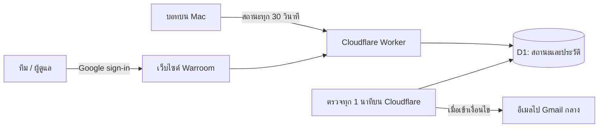

# Warroom: สถานะบอทและงานของทีม

สถานะ: ผู้ใช้อนุมัติให้สร้างแล้ว · พัฒนาและ deploy เว็บแบบล็อกข้อมูลแล้ว 16 พฤศจิกายน 2026 · ตั้ง Google Client ID แล้ว รอทดสอบเข้าสู่ระบบจริงและตั้งอีเมล

## ข้อตกลงแล้ว (Q1–Q30)

- เป้าหมายรวม: ดูทั้งสถานะบอทและงานของทีม เริ่มจากสถานะบอทก่อน
- เฟสแรกเน้นเว็บไซต์ที่ใช้ได้ดีทั้งมือถือและคอม เปิดจากทุกที่ ส่วนช่องทาง WhatsApp ทำภายหลัง
- เว็บไซต์ยังเปิดได้เมื่อ Mac ที่รันบอทปิดหรือหลับ แสดงเวลาที่ได้รับข้อมูลล่าสุด และแสดงเมื่อขาดการติดต่อ
- หน้าแรกบอกสิ่งที่ต้องสนใจและทำต่อ พร้อมเปิดดูรายละเอียดและประวัติได้
- ทีมเห็นภาพรวม ผู้ดูแลเห็นรายละเอียดเพิ่มเติม แต่ทั้งสองระดับไม่เห็นเนื้อหาแชท ชื่อลูกค้า หรือเบอร์โทรในเฟสนี้
- เข้าเว็บด้วยบัญชี Google ของแต่ละคนตามรายชื่อที่อนุญาต กำหนดสิทธิ์ผู้ดูแลรายคน Gmail กลางที่ทีมกำลังเตรียมสมัครใช้รับแจ้งเตือน
- ใช้เหตุการณ์จากข้อความจริง ไม่ส่งข้อความทดสอบอัตโนมัติ กลุ่มเงียบอย่างเดียวไม่ใช่ปัญหา
- แยกสถานะเชื่อมต่อ การส่งคำตอบสำเร็จ และการยืนยันถึงผู้รับ ถ้ายังไม่มีหลักฐาน ให้ระบุว่ายังยืนยันไม่ได้พร้อมเวลาที่ตรวจ
- ไม่มีปุ่มรีสตาร์ตในเฟสแรก มีข้อมูลสถานะ ประวัติ และวิธีรับมือ
- ตั้งเป้าบอทพร้อมทำงาน 24 ชั่วโมง ทั้งนี้ Mac ต้องเปิดและไม่หลับ เว็บไซต์ไม่ได้ทำให้บอททำงานต่อเมื่อเครื่องหลับ
- บอทส่งสถานะทุก 30 วินาที ไม่ใช่ส่งอีเมลทุก 30 วินาที หากไม่รับข้อมูลครบ 2 นาที เว็บระบุว่าข้อมูลไม่อัปเดตและยังยืนยันสถานะปัจจุบันไม่ได้
- เก็บประวัติสถานะและเหตุการณ์ใน Warroom 30 วัน แล้วลบข้อมูลหมดอายุอัตโนมัติ ไม่เปลี่ยนนโยบายเก็บข้อมูลแชทของบอท
- เฟสแรกคงบอทไว้บน Mac ย้ายเฉพาะเว็บและระบบตรวจ/แจ้งเตือนไปบริการออนไลน์ การย้ายตัวบอทออกจาก Mac เป็นงานแยก
- ตรวจบริการที่มีอยู่และโควตาฟรีก่อน นำค่าใช้จ่ายจริงมาให้ดูก่อนเลือกสิ่งที่ต้องจ่ายเพิ่ม ยังไม่รับรองว่าทั้งระบบจะไม่มีค่าใช้จ่าย
- ผู้ใช้ระบุว่าข้อมูลผู้ให้บริการ AI และชื่อโมเดลที่บริการใช้อยู่เป็นสิ่งจำเป็น ต้องอยู่ในเฟสแรกด้วย
- Q30: ทีมเห็นผู้ให้บริการ ชื่อโมเดล และสถานะโดยรวมแยกตามงาน ผู้ดูแลเห็นรายละเอียดการเรียกใช้และข้อผิดพลาดเพิ่มเติม ทั้งสองระดับยังไม่แสดงเนื้อหาแชท
- Q27: ผู้ดูแลเพิ่ม/ถอดสมาชิกด้วยอีเมล Google และกำหนดสิทธิ์ทีม/ผู้ดูแลบนเว็บได้ ไม่เปิดสมัครทั่วไป และป้องกันการถอดผู้ดูแลคนสุดท้าย
- Q28: เฟสแรกแสดงสุขภาพรวมทั้งบอท ไม่แยกกลุ่ม WhatsApp และไม่แสดงชื่อกลุ่ม การแยกสิทธิ์ตามกลุ่มค่อยออกแบบเมื่อเพิ่มสถานะงานของทีม

## หน้าแรก: 6 เรื่อง

1. ติดต่อเครื่องบอทได้ไหม และได้รับข้อมูลล่าสุดเมื่อไร
2. WhatsApp เชื่อมต่ออยู่ไหม
3. รับข้อความ / ส่งคำตอบล่าสุดเมื่อไร
4. งานกำลังทำหรือค้างนานแค่ไหน รวม AI และเรนเดอร์
5. ปัญหาที่พบและสิ่งที่ผู้ดูแลควรทำต่อ
6. ผู้ให้บริการ AI และชื่อโมเดลที่บอทใช้อยู่ แยกตามความสามารถเมื่อใช้ต่างกัน

## แจ้งเตือน

- ช่องทางแรกคืออีเมลไป Gmail กลางของทีม
- เว็บไซต์แสดงเหตุการณ์ทันทีที่ได้รับข้อมูล
- ขาดการติดต่อหรือเชื่อมต่อไม่ได้ต่อเนื่อง 5 นาที: ส่งอีเมลครั้งแรก
- ต้องให้คนช่วย เช่น ลิงก์ WhatsApp ใหม่: แจ้งทันทีเมื่อระบบตรวจพบ
- ปัญหายังไม่หาย: เตือนซ้ำทุก 1 ชั่วโมง รวมเหตุการณ์ของปัญหาเดียวกันเพื่อไม่ส่งซ้ำทุกครั้งที่ตรวจ
- เมื่อฟื้นตัว: ส่งแจ้งหนึ่งครั้ง
- เฉพาะผู้ดูแลพักแจ้งเตือนได้ 30 นาที / 1 ชั่วโมง / 4 ชั่วโมง ยกเลิกก่อนหมดเวลาได้ และกลับมาแจ้งเองเมื่อหมดเวลา
- ระหว่างพัก เว็บยังแสดงปัญหาจริง พร้อมผู้ที่พักและเวลาสิ้นสุด
- เมื่อหมดเวลาพัก ตรวจสถานะแล้วส่งทันทีถ้าปัญหายังเข้าเงื่อนไข จากนั้นเตือนซ้ำรายชั่วโมง ถ้าปัญหาเกิดและหายทั้งหมดระหว่างพัก ให้เก็บประวัติโดยไม่ส่งอีเมลย้อนหลัง
- ยืนยันเพิ่มเติม: 5 นาทีคือเวลารอก่อนแจ้งครั้งแรก ไม่ใช่ความถี่ส่งอีเมลซ้ำ
- AI ล้มเหลวหนึ่งงาน: แสดงบนเว็บ ยังไม่ส่งอีเมลเพียงเพราะครั้งเดียว Q29 ยืนยันเกณฑ์ 3 ครั้งติดกันภายใน 10 นาที แยกตามความสามารถ เมื่อความสามารถนั้นทำสำเร็จให้เริ่มนับใหม่ หากมีเหตุที่ต้องให้ผู้ดูแลแก้ เช่น สิทธิ์ API ใช้ไม่ได้ ให้แจ้งทันที
- งานช้าแสดงประเภทงานและเวลาที่รอ ไม่เหมารวมว่าเป็นงานล้มเหลว

## ข้อมูลที่ยังต้องตั้งก่อนเปิดจริง

- ตั้ง Google OAuth Client ID แล้ว ต้องตรวจ authorized origin และทดสอบเข้าสู่ระบบบัญชีผู้ดูแลคนแรกจริง
- Gmail กลาง/ผู้รับแจ้งเตือนที่ยืนยันแล้ว และโดเมนผู้ส่ง ยังไม่ถือว่าอีเมลผู้ดูแลเป็นผู้รับโดยอัตโนมัติ
- ทดสอบ Google login จริงและการรับอีเมล ก่อนเปิด telemetry ของบอทจริง
- ดูวิธีติดตั้งและผลทดสอบล่าสุดที่ `warroom/README.md` และ `HANDOFF.md`

## ข้อเสนอสถาปัตยกรรมเพื่อพิจารณา

สถาปัตยกรรมด้านล่างได้รับอนุมัติแล้ว สร้าง Worker, Static Assets, D1 และ minute Cron แยกจากบอทบน Mac แล้ว การเข้าสู่ระบบจริงและอีเมลยังรอตั้งค่า

- Workers + Static Assets ให้บริการเว็บและ API; D1 เก็บสถานะ ประวัติ สมาชิก สิทธิ์ session และเหตุการณ์แจ้งเตือน
- บอทส่งออกเฉพาะฟิลด์สถานะที่อนุญาตผ่าน HTTPS พร้อม credential เฉพาะเครื่อง ไม่เปิดฐานข้อมูลแชทหรือเปิดพอร์ต Mac ให้เว็บเข้าถึง
- ส่งสถานะแยกจากคิวตอบแชท มี timeout และคิวส่งแบบจำกัด; การติดตามสถานะล้มเหลวต้องไม่ทำให้การตอบแชทหยุด
- รับสถานะใหม่โดยใช้ลำดับและรหัสรอบการรันเพื่อกันสถานะเก่าย้อนทับ ใช้เวลารับฝั่งเว็บในการตัดสินว่าติดต่อไม่ได้
- Cron ตรวจสถานะทุก 1 นาทีและเก็บการแจ้งที่ต้องส่งไว้ในฐานข้อมูล ใช้การจองงานส่งเพื่อป้องกันรอบตรวจซ้อนส่งซ้ำ การครบเกณฑ์ 5 นาทีหมายถึงมีสิทธิ์แจ้ง ไม่ใช่รับประกันอีเมลเข้า inbox ตรงวินาทีที่ครบ
- เมื่อขาดการติดต่อ ให้แสดงค่าล่าสุดเป็นข้อมูลเก่า ไม่แสดง WhatsApp/AI เป็นปกติปัจจุบัน เหตุที่ซ้อนกันต้องไม่ส่งอีเมลซ้ำอ้างความผิดปกติจากค่าที่ค้างเก่า
- สำหรับ AI ให้แยกชื่อที่ process ตั้งค่า/ขอใช้ กับชื่อจาก response ที่ API รายงาน ไม่มีชื่อใน response ให้ระบุว่ายังไม่ยืนยัน ไม่คัดลอกชื่อที่ขอใช้ไปอ้างเป็นผลจริง
- โมเดล/ผู้ให้บริการในข้อมูลเก่าต้องแสดงเวลาและคำว่าเป็นค่าที่รายงานล่าสุด ไม่อ้างว่าเป็นค่าปัจจุบันเมื่อขาดการติดต่อ
- กลุ่มเงียบ/ไม่ได้เรียก AI ไม่ทำให้สถานะเสีย และไม่ถือว่าปัญหา AI ฟื้นเพียงเพราะครบ 10 นาที ต้องมีหลักฐานการทำงานสำเร็จในความสามารถนั้น
- งานช้าแสดงอายุจริง เฟสแรกไม่ส่งอีเมลเพียงเพราะเรนเดอร์ใช้เวลานาน; หาก watchdog ระบุว่างานคิวหลักถูกขัดจังหวะ ให้แสดงเหตุขัดข้อง ไม่อ้างว่ารีสตาร์ตแล้วงานเดิมสำเร็จ
- Google sign-in ตรวจบัญชีที่ยืนยันและรายชื่ออนุญาตฝั่งเซิร์ฟเวอร์ ตรวจ role ทุก API; ถอดสิทธิ์แล้ว session เดิมเข้าถึงต่อไม่ได้ การป้องกันผู้ดูแลคนสุดท้ายต้องทนคำขอพร้อมกัน
- หน้าผู้ดูแลแสดงรายละเอียดแบบคัดฟิลด์ ไม่แสดง raw request/response/error/stack ซึ่งอาจปนข้อความแชทหรือข้อมูลลับ

### บริการและราคา (ตรวจ 16 พฤศจิกายน 2026)

- ตรวจผ่าน connector พบว่ามีบัญชี Cloudflare และ Workers เดิมใช้งานอยู่ สามารถเสนอใช้บัญชีเดิมได้ แต่ยังไม่ได้เลือกชื่อบริการหรือเปลี่ยนทรัพยากร
- การอ่าน subscriptions ได้ HTTP 403 เพราะ OAuth connection นี้ไม่รองรับ endpoint การเงิน จึงยังยืนยันแผนและโควตาที่เหลือจริงไม่ได้ ไม่มีการขอสิทธิ์เพิ่ม
- Workers Free: 100,000 requests/วัน และ CPU 10 ms ต่อ invocation; Workers Paid ขั้นต่ำ US$5/เดือนต่อบัญชี ไม่ใช่ราคาที่เรียกเก็บเพิ่มแน่นอนสำหรับงานนี้ [Workers pricing](https://developers.cloudflare.com/workers/platform/pricing/)
- D1 Free: อ่าน 5 ล้านแถว/วัน เขียน 100,000 แถว/วัน และพื้นที่รวม 5 GB การเขียน/ลบและ index มีผลต่อ usage [D1 pricing](https://developers.cloudflare.com/d1/platform/pricing/)
- คำนวณจากข้อตกลง: ส่งสถานะทุก 30 วินาที = 2,880 ครั้ง/วัน และ Cron ทุกนาที = 1,440 รอบ/วัน ยังไม่รวมผู้เปิดหน้าเว็บ เหตุการณ์เพิ่มเติม และ retry ต้องทดสอบ CPU กับจำนวนแถวอ่านจริงก่อนสรุปว่าอยู่ในโควตา [Cron Triggers](https://developers.cloudflare.com/workers/configuration/cron-triggers/)
- ส่งอีเมลไป verified destination ฟรีบน Free/Paid และไม่นับโควตาอีเมล ส่วนส่งไปผู้รับทั่วไปต้อง Paid; ผู้ส่งต้องอยู่บนโดเมนที่ตั้งค่ากับ Email Service [Email pricing](https://developers.cloudflare.com/email-service/platform/pricing/), [Send bindings](https://developers.cloudflare.com/email-service/configuration/send-bindings/)
- ตรวจบัญชีที่เชื่อมต่อพบ Email Routing ยังไม่เปิดและไม่มี verified destination การใช้เส้นทางนี้ต้องตั้งค่าโดเมนผู้ส่งและยืนยัน Gmail กลางก่อน ห้ามถือว่ามีบริการส่งพร้อมอยู่แล้ว
- เสนอเริ่มด้วย Workers hostname สำหรับเว็บ และพิจารณาโดเมนย่อยสำหรับผู้ส่งอีเมลแยก ตรวจ DNS เดิมก่อนเปลี่ยนค่า ไม่เพิ่มค่าโดเมนหรือแผนจ่ายเงินโดยอัตโนมัติ
- ข้อสรุปเป็นการประเมิน: โหลดยังมีโอกาสอยู่ในโควตาฟรี/โควตาที่มี แต่ต้องรวมการใช้งานโปรเจกต์อื่นและทดสอบจริง ค่า AI ของบอทยังคงแยกจากค่า Warroom และไม่ได้เพิ่มการเรียก AI เพียงเพื่อเช็กสถานะ

### เกณฑ์รับงานที่เสนอ

1. มือถือและคอมดูครบ 6 หัวข้อ พร้อมเวลาและสถานะที่ยังยืนยันไม่ได้ ไม่มีเนื้อหาแชทหรือข้อมูลลับใน API/หน้าเว็บ
2. ทดสอบทีม/ผู้ดูแล/บัญชีนอก allowlist รวมการเรียก API โดยตรง การถอดสมาชิกและผู้ดูแลคนสุดท้าย
3. ใช้สถานะจำลองทดสอบขาดข้อมูล 2 นาที/5 นาที หลุดแล้วฟื้น แจ้งซ้ำรายชั่วโมง และพัก/หมดพัก โดยไม่ส่งข้อความทดสอบเข้ากลุ่มจริง
4. ทดสอบ AI ผิดพลาดแยกความสามารถ 3 ครั้งติดกันใน 10 นาที สลับสำเร็จ กรณีไม่มีคำขอใหม่ และเหตุที่ต้องให้คนช่วย
5. ทดสอบส่งคำตอบล้มเหลว สร้างภาพสำเร็จแต่ส่งไม่สำเร็จ รีสตาร์ตระหว่างงาน และไม่มี delivery receipt โดยไม่รายงานความสำเร็จเกินหลักฐาน
6. ทดสอบ email send failure/retry/งานตรวจซ้อนให้เห็นการส่งไม่สำเร็จจริง ไม่แสดงว่าส่งถึงเพียงเพราะบริการรับคำขอ
7. ตรวจ D1 queries ว่าใช้ index/จำกัดผลลัพธ์ ตรวจ CPU และ retention 30 วันด้วยข้อมูลสังเคราะห์ ก่อนเชื่อมข้อมูลสถานะจริง
8. เมื่อพร้อมทดสอบออนไลน์ ใช้กล่องผู้ดูแลที่ยืนยันและประสานช่วงทดสอบจริงก่อน ไม่หยุดบอทจริงหรือส่งอีเมล/ข้อความทดสอบระหว่างขั้นออกแบบนี้

## การตรวจความเป็นไปได้

พบว่า bot_messages.sent_at ถูกบันทึกก่อนรอผลส่งข้อความ จึงใช้ค่านี้เป็นหลักฐานส่งสำเร็จไม่ได้ และสถานะเรนเดอร์ done ถูกบันทึกก่อนส่งรูป จึงไม่ได้หมายถึงส่งถึงผู้รับ ต้องเพิ่มหลักฐานผลลัพธ์ที่ถูกจุดก่อนแสดงสถานะเหล่านี้

ผลตรวจ source เพิ่มเติม (ยังไม่ได้เพิ่มความสามารถเหล่านี้):

- ยังไม่มี handler เก็บ delivery receipt จึงยังยืนยันถึงผู้รับไม่ได้
- messages.ts เป็นเวลาส่งข้อความ ไม่ใช่เวลาที่บอทได้รับ event ต้องแยกข้อความใหม่ ประวัติเก่า และข้อความสะท้อนกลับของบอท
- คิวหลักมี watchdog แต่ยังไม่มีข้อมูลจำนวนงาน อายุงาน และวงจรเริ่ม/จบคำขอที่คงอยู่หลังรีสตาร์ต คิวเรนเดอร์แยกและอยู่ในหน่วยความจำ
- การมี sock.user ไม่ได้ยืนยันว่า WhatsApp ยังเชื่อมต่อ ต้องติดตาม connection events
- การขาดสถานะบอกได้ว่าติดต่อไม่ได้ แต่แยกสาเหตุเครื่องหลับ อินเทอร์เน็ตขาด หรือทางส่งสถานะเสียจากเว็บอย่างเดียวไม่ได้
- การส่งสถานะกลับมา การต่อ WhatsApp ได้ และการตอบสำเร็จเป็นหลักฐานคนละเรื่อง ต้องไม่ประกาศว่าฟื้นทั้งหมดจากเพียงข้อมูลสถานะกลับมา
- ระบบตรวจข้อมูลขาดและส่งอีเมลต้องทำงานอยู่นอก Mac ของบอท มิฉะนั้นจะเตือนไม่ได้ตอนเครื่องหยุด
- ห้ามอัปโหลด raw logs: มีข้อมูลแชท ชื่อ และข้อมูลจับคู่ ให้สร้างข้อมูลสถานะจากรายการฟิลด์ที่อนุญาตเท่านั้น

ข้อค้นพบข้างต้นเป็นหลักฐานก่อนเพิ่ม telemetry; โค้ดใหม่เก็บ send completion/ACK/queue/response model แล้ว แต่ยังไม่ได้โหลดในบอทจริง

แหล่งตรวจ: src/bot.js (send/sendImage, processMessage, socket events, render queue), src/db.js (recordBotMessage/addRender), src/serial-queue.js, src/ai.js และ scripts/autostart.sh ใน working tree ปัจจุบัน

### หลักฐานผู้ให้บริการและโมเดล

- Source ใช้ provider/model หลักร่วมกันสำหรับถามตอบ จัดการงาน สรุปแชท และอ่านภาพ/PDF ส่วนเรนเดอร์ใช้ OpenAI image model แยกต่างหาก ข้อความเตือนตามกำหนดและสรุปงานตอนเช้าประกอบด้วยโค้ด ไม่ได้เรียก AI ทุกครั้ง
- ค่า default ใน src/config.js ไม่ใช่หลักฐานว่า process จริงใช้ค่าใด ต้องรับเฉพาะข้อมูล provider/model ที่อนุญาตจาก process ที่รัน ไม่ส่ง environment ทั้งชุด
- src/ai.js ลดผลตอบกลับเหลือข้อความ/JSON จึงยังไม่เก็บโมเดลจาก response, usage หรือเวลาเรียก ส่วน model ที่คืนจาก renderImage เป็นชื่อที่ขอใช้ ไม่ใช่หลักฐานโมเดลจาก response
- เส้นทาง Claude อนุญาต server-side fallback แต่ยังไม่มีหลักฐานว่าคำขอใดเปลี่ยนโมเดลจริง จึงควรแยกโมเดลที่ตั้งค่า/ขอใช้กับโมเดลในผลตอบกลับ ถ้า API ไม่รายงานให้ระบุว่ายังยืนยันไม่ได้
- ไม่ใช้ข้อความจาก explainError ระบุผู้ให้บริการของเรนเดอร์ เพราะฟังก์ชันเลือกชื่อจาก provider หลักของงานข้อความ

ตรวจจาก src/config.js, src/ai.js, src/tasks.js, src/summarize.js และ src/describe.js โดยไม่ได้อ่าน environment ลับหรือเรียก AI จริง
